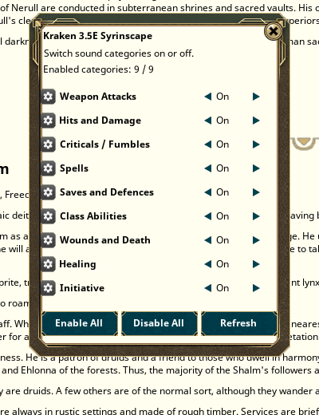

# Kraken AD&D 2E Syrinscape

Syrinscape sounds for AD&D 2E in Fantasy Grounds Unity, played from the game's own chat: every
attack, hit, critical, fumble, spell, save, class ability, wound, heal and initiative roll can
make a sound. It uses Fantasy Grounds' own Syrinscape link (Settings > Sound > Syrinscape), so
there is nothing to paste in. Host (GM) side only: players hear the sounds through the
Syrinscape web player.

Built on the same design as Kraken Traveller 2E Syrinscape 0.7.0.

## What makes a sound

| Category | Sounds |
| --- | --- |
| Weapon Attacks | the swing or shot of the weapon named on the attack roll (swords, axes, maces, bows, crossbows, slings, polearms, natural attacks: bite, claw, gore, sting...) |
| Hits and Damage | the weapon's hit on its damage roll, or the damage type (fire, cold, acid, lightning, poison, slashing, piercing, bludgeoning, force...) |
| Criticals / Fumbles | critical hits, fumbles, automatic misses, Kraken Krits & Fumbles results |
| Spells | **every spell of the game** (903 spells): a Syrinscape recording of that spell where one exists (D&D and Pathfinder caster sets), else a related spell, the spell's energy or school, or the caster's own "Nth level spell" sound |
| Saves and Defences | saving throws, spell saves, resistances, mirror image, stoneskin, displacement, broken concentration |
| Class Abilities | turn and rebuke undead, rage, smite, lay on hands, sneak attack and backstab, inspire courage and bardic music, eldritch blast, stunning fist, wild shape |
| Wounds and Death | wounded, heavy, critical, dying, unconscious, dead |
| Healing | heal rolls |
| Initiative | initiative rolls |

## Settings (Options > Kraken Syrinscape, campaign-wide)

| Option | Values | Default |
| --- | --- | --- |
| Sound triggers | On / Off | On |
| Hidden GM rolls | Silent / Combat only / All | Combat only |
| Sounds: (each category) | On / Off | On |
| Attack roll sound | Every attack / Misses only / Off | Every attack |
| Damage roll sound | Weapon / Damage type / Both | Weapon |
| Spell sounds | Every spell / Named recordings only / Off | Every spell |
| Same sound again after | 1 / 3 / 5 / 10 seconds | 1 second |
| Startup message in chat | On / Off | On |
| Show trigger matches in chat | On / Off | Off |

## Commands

`/krakensyrin help`, `config` (category window), `categories`, `toggle <category> [on|off]`, `on`, `off`,
`hidden off|combat|all`, `spells all|exact|off`, `status`, `invite` (Fantasy Grounds' own player invite),
`test <sound_key>`, `why <chat text>` (which sounds a line would play), `debug on|off`.
`/ccsyrin` still works.

## Install

Copy the `KrakenADD2ESyrinscape` folder (or `.ext`) into your Fantasy Grounds `extensions` folder, tick
**Kraken AD&D 2E Syrinscape** for a AD&D 2E campaign, and set up Syrinscape in Fantasy Grounds' sound settings.

Settings from older versions (slash-command switches) carry over into the new Options once.
